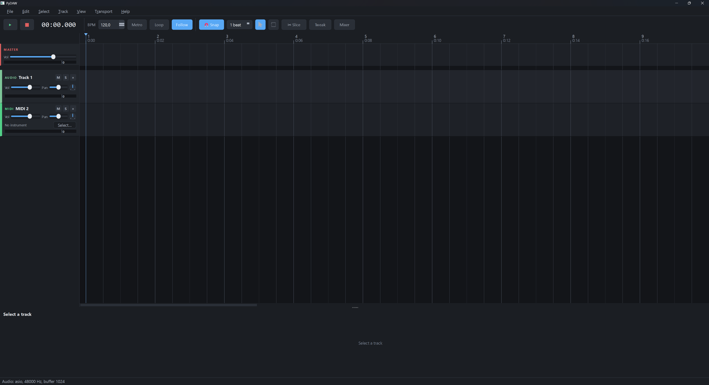
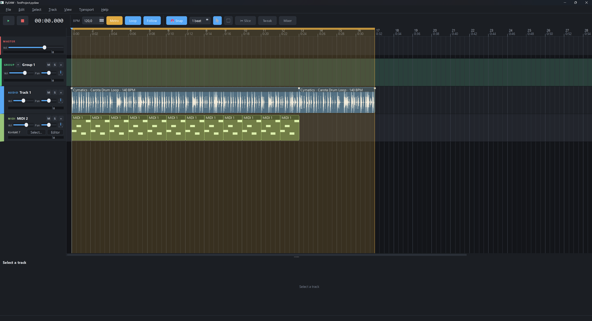
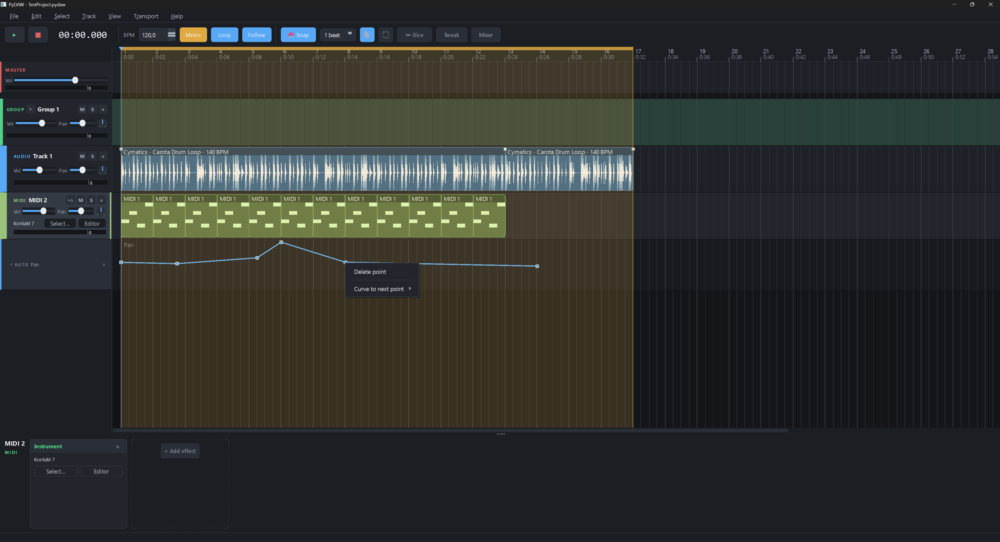

# PyDAW


Digital Audio Workstation with a Python UI (PySide6) and a C++ audio engine (RtAudio + dr_libs, wrapped with pybind11).

## 🎵 Features

- **Multi-track timeline**: drag & drop audio files (WAV/FLAC/MP3/AIFF) onto tracks, move clips, zoom with the mouse wheel (Ctrl+wheel), click on empty space to seek
- **Real-time playback**: WASAPI, ASIO, 48 kHz, mixing with gain/pan/mute/solo per track
- **Master section**: master volume, limiter, peak meters
- **Waveforms**: clip waveform display (peak cache computed in C++)
- **Undo/Redo**: full undo support for track and clip operations
- **Projects**: save/load projects (JSON, `.pydaw` files), export the mix to WAV
- **Extensibility**: the engine exposes an `EffectSlot` interface for future VST3 hosting

## 📦 Installation

### Requirements

- Python 3.10+
- MSVC (Visual Studio Build Tools) on Windows
- CMake, Ninja

### Option 1: Install from source

```powershell
# Clone the repository
git clone https://github.com/TheJustSavior/PyDAW.git
cd PyDAW

# Install build dependencies
pip install cmake ninja pybind11 scikit-build-core

# Build and install the project
pip install -e . --no-build-isolation
```

### Option 2: Standalone build (recommended for users)

Download the ready-made executable from the [Releases](https://github.com/TheJustSavior/PyDAW/releases) page:

1. Download `PyDAW-vX.X.X-Windows-x64.zip`
2. Extract the archive into any folder
3. Run `PyDAW.exe`

Python installation is not required.

> **Note**: The application starts with a console window. Keep it open while
> using PyDAW — if the app crashes, the console stays open and shows the full
> error traceback so you can copy it into a GitHub issue.

### Option 3: Build your own standalone version

For developers who want to create a self-contained build:

```powershell
pip install pyinstaller
py build_exe.py
```

See [BUILD_STANDALONE.md](BUILD_STANDALONE.md) for details.

## 🚀 Running

Double-click `run.bat` in the project root, or run from the console:

```powershell
.\run.bat        # or: py -m pydaw
```

## 🧪 Tests

```powershell
python tests/test_engine.py
```

The test runs without a GUI: it generates tone WAV files, loads them through the
engine (with resampling), assembles a project from 2 tracks, saves/loads it, and
exports the mix.

## 📁 Project structure

- `engine/src/` — C++ engine: `audio_engine` (device, transport, command queue), `mixer` (tracks, clips, summing), `audio_file` (decoding, resampling, peaks)
- `pydaw/` — Python: `model/` (Project/Track/Clip, undo), `ui/` (timeline, tracks, transport), `engine_bridge.py` (the single access point to the engine)
- `tests/` — engine and feature tests

Architecture details are in [PLAN.md](PLAN.md).

## 📝 License

MIT License. See [LICENSE](LICENSE).

## 🤝 Contributing

Pull requests are welcome! For large changes, please open an issue first to discuss what you would like to change.

**Found a crash?** The standalone build keeps a console window open. If PyDAW
crashes, the console shows the full error traceback. Please copy that error text
and paste it into a new [GitHub Issue](https://github.com/TheJustSavior/PyDAW/issues)
so we can track down and fix the problem.

## 📸 Screenshots


*Main window with the multi-track timeline*


*Timeline with clips*


*Timeline with an automation example*
